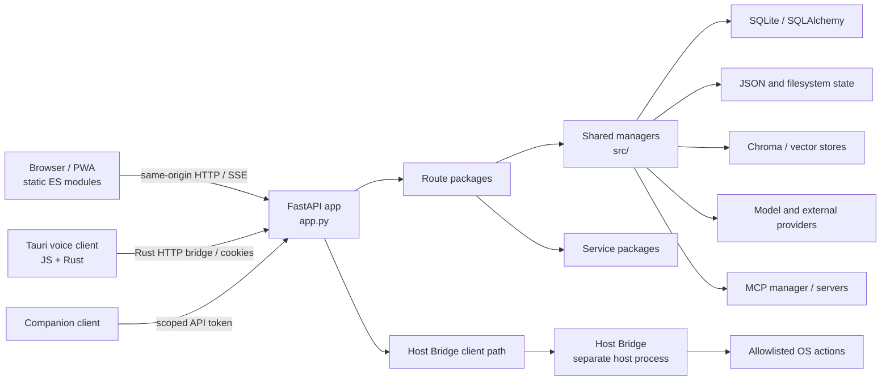

# Jarvis AI Architecture Overview

This document is a source-grounded entry map to the current repository. It
summarizes the boundaries between the browser app, backend, persistence,
desktop client, Host Bridge, and deployment. The detailed implementation
contracts remain in the [subsystem specifications](../specs/_readme.md); this
overview links to them rather than replacing them.

## Evidence and scope

- **Verified** means the relationship was checked against current source code.
- **Documented** means the statement is stated in project documentation or a
  subsystem specification.
- **Inferred** means call sites and ownership imply the relationship, but no
  single module declares it as a contract.
- **Unverified** means the behavior requires runtime, platform, or deployment
  verification not performed for this document.

The source of truth is the checked-out `main` branch at
`07d516338b3765a5e27f606822e6f9edaddf8e15`. At inventory time, the index
contained 1,643 tracked paths. That inventory is not a claim that every file
was read. This reconstruction inspected representative startup, persistence,
security, backend-domain, frontend, desktop, Host Bridge, deployment, and test
sources and used the subsystem map to find canonical owners. It is an
architecture map, not a line-by-line audit or a claim that every behavior was
runtime-tested.

The three backend source-review records enumerate 43 unique directly opened
source/config paths (mostly selected ranges); additional frontend/deployment
reads and targeted search excerpts were not captured in a complete path
inventory. Thus 43 is a confirmed partial count, not the total number of files
reviewed.

## 1. Product and boundaries

**Documented:** The project presents itself as a self-hosted AI workspace and
personal agent, with chat, voice, tools, persistent memory, research,
documents, email, calendar, notes, and local-model workflows
([`README.md`](../README.md)).

**Verified:** The primary server is a FastAPI application assembled in
[`app.py`](../app.py). Its browser client is a static same-origin application
served from [`static/`](../static/). A separate Tauri desktop voice client
lives under [`desktop/`](../desktop/), and host desktop operations are exposed
through the standalone [`host_bridge/`](../host_bridge/) service.

The repository includes feature implementations and integrations whose
availability depends on installed optional packages, external services,
provider credentials, desktop permissions, or platform-specific APIs.
Presence of a route or UI does not itself prove a deployment has the required
dependency or that the feature has been exercised in that environment.

## 2. Repository map

The following inventory counts Git-tracked paths in the current checkout.
Categories intentionally overlap: for example, tests are Python/JavaScript
files and deployment configuration is also documentation/configuration.

| Area | Tracked paths | Responsibility |
|---|---:|---|
| `src/` | 157 | Runtime managers, agent/LLM, integrations, persistence helpers |
| `core/` | 12 | Database, auth, middleware, atomic and secure file primitives |
| `routes/` | 86 | HTTP API and feature route packages/shims |
| `services/` | 44 | Service-layer implementations, including search |
| `tests/` | 878 | Python, JavaScript, fixtures, helpers, and test documentation |
| `desktop/` | 23 | Tauri/Rust host, vanilla-JS voice overlay, four Node test files |
| `specs/` | 61 | Subsystem specifications and provider documentation |
| `static/` | 223 | Browser UI, modules, styles, vendor code, fonts, icons, PWA assets |
| `website/` | 17 | Project landing/setup website |
| `host_bridge/` | 6 | Standalone host-side action service |
| `companion/` | 5 | Companion pairing and API |
| `mcp_servers/` | 5 | Built-in MCP server implementations |
| `integrations/` | 7 | Codex/Claude integration assets |
| Root-level tracked files | 92 | Entrypoints, packaging, configuration, docs, launchers |

Other significant top-level areas include `.github/` workflows and templates,
`docker/` and Compose overlays, `scripts/` (with Docker diagnostics under
`scripts/docker/`), `assets/`, `config/`, `swift/`,
`licenses/`, and root platform launchers. There are 335 tracked Python files
outside `tests/`; the `tests/` tree contains 878 tracked paths (864 Python
files and 14 JavaScript/TypeScript-family files), plus four tracked Node test
files under `desktop/tests/`. These are file counts, not test-case counts.
Across the repository there are 1,199 tracked `.py` files and 188 `.js` files;
the latter count includes vendored and test files and is not a first-party
frontend source count.
There are 89 tracked Markdown files overall, 61 tracked files under `specs/`,
and 29 tracked files under `static/lib/` for vendored browser libraries.

Tracked deployment/configuration includes 21 `.github/` paths, five under
`docker/`, three root Compose files, and separate Dockerfile, native launchers,
and service definitions. The tracked lockfiles are two npm
`package-lock.json` files and `desktop/src-tauri/Cargo.lock`. Six files live in
`static/js/editor/build/`; despite the directory name, these are tracked
first-party editor modules, not generated distribution output. No tracked
`node_modules/`, `desktop/dist/`, or Rust `target/` output was counted as
source. Static media, fonts, icons, and vendored libraries remain separate
from application logic.

Canonical source maps:

- Startup and route wiring: [`specs/runtime.md`](../specs/runtime.md)
- Auth, authorization, and trust boundaries:
  [`specs/auth-security.md`](../specs/auth-security.md)
- Durable state: [`specs/persistence.md`](../specs/persistence.md)
- Tool lifecycle and policy: [`specs/agent-tools.md`](../specs/agent-tools.md)
- Frontend modules: [`specs/frontend.md`](../specs/frontend.md)
- Test and deployment commands:
  [`specs/testing-devops.md`](../specs/testing-devops.md)
- All subsystem documents:
  [`specs/_readme.md`](../specs/_readme.md)

## 3. System architecture

**Verified at the code-boundary level:**



The diagram describes code ownership and integration points, not a guaranteed
deployment topology. In particular, Chroma, model providers, MCP servers, and
the Host Bridge can be absent or configured separately.

## 4. Startup and lifecycle

### Entrypoints

- **Verified:** `python app.py` starts Uvicorn directly
  ([`app.py`](../app.py)); the packaged launcher
  ([`launcher.py`](../launcher.py)) initializes the same `app.app` and then
  starts Uvicorn.
- **Verified:** `setup.py` performs environment/setup work, creates required
  directories, initializes the database, and can create the initial admin.
  It is also invoked by the Docker entrypoint; it is not the HTTP server.
- **Verified:** `run_host_bridge.py` is a distinct executable for the
  host-side action service.

### Application sequence

```mermaid
sequenceDiagram
    participant Entry as app.py / launcher.py
    participant DB as core.database
    participant Init as src.app_initializer
    participant App as FastAPI app
    participant Life as FastAPI lifespan
    Entry->>DB: import; create schema and run startup migrations
    Entry->>Init: construct shared managers
    Init-->>Entry: sessions, memory, uploads, chat/research, model discovery
    Entry->>App: register middleware, static mounts, routes and health endpoints
    App->>Life: enter lifespan
    Life->>Life: reconcile/start background tasks and optional warmups
    Life-->>App: serve requests
    App->>Life: shutdown
    Life->>Life: stop scheduler, cleanup tasks, close webhooks and MCP
```

- **Verified:** Importing [`core/database.py`](../core/database.py) invokes
  `init_db()`. It creates missing SQLAlchemy tables and runs hand-written,
  idempotent migrations before the FastAPI lifespan begins; the project does
  not use Alembic.
- **Verified/documented:** SQLite is the default and migration target. Although
  SQLAlchemy can be configured with another `DATABASE_URL`, startup migration
  and backfill code is SQLite-first and is not fully backend-neutral.
- **Verified:** [`src/app_initializer.py`](../src/app_initializer.py) creates
  shared managers, which [`app.py`](../app.py) stores on `app.state` and
  passes to route setup functions. App-level auth, RAG, TTS/STT, scheduler,
  MCP, webhooks, and event/AI integration state are wired separately.
- **Verified:** Lifespan starts cleanup/monitoring, MCP setup, optional warmups,
  scheduled-task reconciliation, and periodic work; exact optionality is
  controlled by feature/environment settings. Shutdown cancels or closes the
  upload cleanup, scheduler, webhook manager, and MCP connections.
- **Verified:** Middleware registration and route ordering live in
  [`app.py`](../app.py); `AuthMiddleware` is added after other middleware and
  is outermost under Starlette's wrapping behavior.

For exact router registration and optional startup gates, see
[`specs/runtime.md`](../specs/runtime.md).

## 5. Backend layers and ownership

| Layer | Canonical owner | Role |
|---|---|---|
| HTTP composition | [`app.py`](../app.py) | FastAPI instance, middleware, route setup, static serving, lifespan |
| Shared manager construction | [`src/app_initializer.py`](../src/app_initializer.py) | Builds process-shared feature managers |
| Route/API boundary | [`routes/`](../routes/) | HTTP validation, request ownership, endpoint orchestration |
| Core infrastructure | [`core/`](../core/) | SQLAlchemy models, auth, middleware, secure and atomic file operations |
| Runtime/service managers | [`src/`](../src/) | Agent, LLM, memory, search compatibility, integrations and scheduling |
| Domain service packages | [`services/`](../services/) | Service implementations, including canonical search |
| Built-in MCP servers | [`mcp_servers/`](../mcp_servers/) | MCP server-specific tool adapters |

The app's router wiring is explicit in `app.py`; some older top-level route
modules are compatibility shims that point at package implementations.
Likewise, `src/database.py` re-exports `core.database`, and several `src.search`
modules wrap `services.search`. Check the canonical implementation and current
call sites before changing a shim or duplicate-looking module.

### Implemented dependency-boundary change

`src/tool_contracts.py` is the canonical owner of `ToolBlock` and `TOOL_TAGS`.
The parser, schema converter, and `src.agent_tools` compatibility facade import
these shared contracts without importing one another to obtain them. This
removes the confirmed cold-import cycle that previously made a direct
`import src.tool_parsing` fail; `src.agent_tools` continues to re-export the
same objects for existing callers. The contract still incorporates the
security-owned built-in email tool names, so this is a targeted dependency
correction, not a fully isolated domain layer.

| Existing ownership | New canonical owner | Consumers and compatibility | Runtime risk / verification |
|---|---|---|---|
| `ToolBlock` and `TOOL_TAGS` in `src/agent_tools/__init__.py` | `src/tool_contracts.py` | `src/tool_parsing.py`, `src/tool_schemas.py`, `routes/model_routes.py`; the facade re-exports identical objects | No filesystem or entrypoint change. Cold parser import, policy/schema loading, facade identity, and focused tests verified. |

The repository has not been globally moved into new `application/`,
`domain/`, or `infrastructure/` trees. Existing entrypoints, package shims,
static asset URLs, launcher paths, and packaging layouts remain in place while
additional changes are evaluated against their runtime consumers.

### Chat, LLM, and tools

```mermaid
sequenceDiagram
    participant UI as static/js/chat.js
    participant Route as routes/chat_routes.py
    participant Ctx as src/chat_processor.py
    participant LLM as src/llm_core.py
    participant Loop as src/agent_loop.py
    participant Exec as src/tool_execution.py
    participant Store as SessionManager / DB
    UI->>Route: chat request
    Route->>Ctx: prepare context and owner-scoped state
    Ctx-->>Route: context preface (memory/RAG/search as applicable)
    Route->>LLM: ordinary chat or agent turn
    LLM-->>Route: normalized stream/events
    Route->>Loop: agent mode only
    Loop->>Loop: retrieve relevant tools and assemble schemas
    Loop->>Exec: dispatch requested tool after policy gates
    Exec-->>Loop: tool result or policy-blocked result
    Loop-->>Route: final response and tool events
    Route->>Store: persist messages/session state
    Route-->>UI: streamed response/events
```

- **Verified:** `routes/chat_routes.py` selects ordinary `src.llm_core` chat or
  `src.agent_loop` for agent mode. `src/chat_processor.py` assembles relevant
  context; the session manager owns conversation persistence.
- **Verified:** `src.llm_core` constructs provider requests and normalizes
  provider stream/tool-call events. `src.agent_loop` retrieves context and
  tools, iterates execution rounds, and returns tool results to the model.
- **Verified:** Tool behavior has distinct gates:
  1. **Availability/retrieval:** `src/tool_index.py` supplies candidate tools;
     retrieval is not an authorization boundary.
  2. **Schema exposure:** agent policy and prompt assembly decide which tool
     schemas are shown to the model for that turn. Guide-only/no-tools policy
     can hide schemas and suppress MCP/tool retrieval.
  3. **Execution authorization:** `src/tool_execution.py` applies hard
     disabled/admin/public-policy checks, path confinement, and MCP dispatch
     restrictions before invoking handlers. A tool name being retrievable or
     present in a prompt does not itself authorize execution.
- **Verified:** Approval scopes and plan-mode restrictions are additional
  policy surfaces; the browser is not the enforcement boundary. See
  [`specs/agent-tools.md`](../specs/agent-tools.md) and
  [`specs/context-building.md`](../specs/context-building.md).

### Provider and model flow

- [`routes/model_routes.py`](../routes/model_routes.py) owns endpoint/model
  management APIs.
- [`core/database.py`](../core/database.py) owns `ModelEndpoint` and provider
  authentication SQL models.
- [`src/endpoint_resolver.py`](../src/endpoint_resolver.py) resolves endpoint
  configuration and credentials; [`src/llm_core.py`](../src/llm_core.py)
  makes provider calls and streams results.
- `ModelDiscovery` is constructed in `src/app_initializer.py`. Provider/model
  compatibility and capabilities have their own detail in
  [`specs/llm-models.md`](../specs/llm-models.md),
  [`specs/model-capability-canonical.md`](../specs/model-capability-canonical.md),
  [`specs/model-quirks.md`](../specs/model-quirks.md), and
  [`specs/model-providers/_readme.md`](../specs/model-providers/_readme.md).

## 6. Domain subsystem map

This is an ownership index, not a claim that every optional feature is
available in every installation. Frontend and test names below were
**inventoried by path**; their presence does not establish that each test was
read or that it proves the full feature. The subsystem specs contain broader
call-site, compatibility, and test notes. In the table, frontend module names
are relative to `static/js/` unless a nested directory is shown; test names
are relative to `tests/`.

| Domain | Route/API owner | Service and persistence owner | Frontend consumer(s) | Representative test path(s) |
|---|---|---|---|---|
| Chat/sessions | `routes/chat_routes.py`, history routes | `src/chat_processor.py`, `src/agent_loop.py`, `core/session_manager.py`; SQL session/message rows | `static/js/chat.js`, `chatStream.js`, `chatRenderer.js`, `sessions.js` | `tests/test_chat_stream_scope.py`, `test_chat_attachment_picker.py` |
| Compare | `routes/compare/` | Compare SQL summary rows; active vote state also in browser localStorage | `static/js/compare/index.js`, `panes.js`, `scoreboard.js` | `tests/test_compare_js.py`, `test_blind_compare_redaction.py` |
| Deep research | `routes/research/` | `src/research_handler.py`, `src/deep_research.py`; data-dir report/state files | `static/js/research/panel.js`, `jobs.js`, `researchSynapse.js` | `tests/test_research_service.py`, `test_research_owner_scope_routes.py` |
| Search/fetch | `routes/search/` | Canonical `services.search`; `src.search` has compatibility wrappers; provider/cache state is service-owned | `static/js/search.js`, `search-chat.js` | `tests/test_search_query.py`, `test_search_ranking.py` |
| Documents/uploads/RAG | `routes/document/`, personal-doc and upload routes | `src` document/upload managers; SQL metadata plus files; optional Chroma/vector integration | `static/js/document.js`, `documentLibrary.js`, `fileHandler.js`, `rag.js` | `tests/test_upload_handler_atomicity.py`, `test_upload_routes_owner_scope.py`, `test_rag_manager_owner_compat.py` |
| Memory/skills | `routes/memory/`, skills routes | `src/memory.py` with JSON primary store and SQLite mirror; skills managers own disk files | `static/js/memory.js`, `skills.js` | `tests/test_memory_owner_isolation.py`, `test_skill_importer_security.py` |
| Models/providers | `routes/model_routes.py` | `src/endpoint_resolver.py`, `src/llm_core.py`; SQL endpoint/provider-auth rows | `static/js/models.js`, `modelPicker.js`, `admin.js` | `tests/test_model_routes.py`, `test_endpoint_resolver_models.py` |
| Email/contacts | `routes/email_routes.py`, `routes/contacts/` | Email account secrets in SQL; scheduled mail in auxiliary SQLite; contacts JSON | `static/js/emailInbox.js`, `emailLibrary.js`, `emailShared.js`, `settings.js` | `tests/test_email_owner_scope.py`, `test_contacts_carddav_security.py` |
| Calendar/tasks/notes | Calendar, task, and note route packages | CalDAV sync/writeback; SQL calendars/events/tasks/notes | `static/js/calendar.js`, `tasks.js`, `notes.js`, `assistant.js` | `tests/test_calendar_owner_scope.py`, `test_task_scheduler_cancel.py`, `test_notes_fail_closed_auth.py` |
| Cookbook/HW fit | `routes/cookbook_routes.py`, HW-fit routes | Cookbook state file; `services.hwfit` detection/ranking; serving is optional/platform-specific | `static/js/cookbook.js`, `cookbookServe.js`, `cookbook-hwfit.js` | `tests/test_cookbook_serve_lifecycle.py`, `test_hwfit_cpu_only_fallback.py` |
| Gallery/media | Gallery, editor, signature routes | SQL metadata plus generated image/media files | `static/js/gallery.js`, `galleryEditor.js`, `editor/`, `signature.js` | `tests/test_gallery_album_owner_scope.py`, `test_editor_draft_payload.py` |
| Speech | `routes/stt_routes.py`, `routes/tts_routes.py` | `services.stt.STTService`, `services.tts.TTSService`; model/cache files | `static/js/voiceRecorder.js`, `tts-ai.js`; desktop voice client | `tests/test_voice_first_flow.py`, `test_stt_audio_formats.py`, `test_tts_cache_stats.py` |
| MCP | `routes/mcp/` | `src/mcp_manager.py`, `src/builtin_mcp.py`; server config in SQL, OAuth JSON files | `static/js/settings.js`, `admin.js`; agent schemas | `tests/test_mcp_manager.py`, `test_mcp_oauth_secure_storage.py` |
| Vault/settings/admin/backup | Vault, prefs, auth, backup, diagnostics, admin-wipe routes | `src/settings.py`, `core/auth.py`; domain SQL/JSON stores | `static/js/settings.js`, `settings/registry.js`, `admin.js`, `presets.js` | `tests/test_settings_scrub.py`, `test_backup_cli_security.py`, `test_vault_password_not_in_argv.py` |
| Webhooks | `routes/webhook/` | `src/webhook_manager.py`; admin-global SQL rows | `static/js/settings.js`, `tasks.js` | `tests/test_webhook_ssrf_resilience.py`, `test_webhook_emitters_use_manager.py` |
| Companion/coding agents | `companion/routes.py`, scoped Codex/Claude API routes | Pairing issues chat-scoped DB API tokens; integration assets under `integrations/` | No dedicated companion/Codex/Claude SPA module listed; settings/admin panels and server-rendered pairing form | `tests/test_companion_pairing.py`, `test_companion_readonly.py`, `test_codex_ssh_host_validation.py` |
| Shell/background jobs | Shell routes and tool execution | `src/tool_execution.py`, background-job managers and disk-backed job state | Chat/stream modules; settings/admin controls | `tests/test_shell_routes.py`, `test_bg_jobs_store.py`, `test_bg_monitor_stream.py` |
| YouTube/notifications | No dedicated YouTube route; task notifications use task routes | `services.youtube` is initialized at startup and used in chat preprocessing; `services.notification.ntfy` handles ntfy helpers | Chat/context and task UI | No YouTube-specific frontend route identified; see context/task tests in their subsystem specs |

For detailed persistence, ownership, and backup/migration boundaries, consult
[`specs/persistence.md`](../specs/persistence.md) and the owning domain spec.

### Domain backup and migration handoff

| Persistent domain | Backup/restore boundary | Schema or file migration owner |
|---|---|---|
| Chat, sessions, compare | Local data snapshot includes the app DB; HTTP JSON export does not. Compare's active browser scoreboard state remains in localStorage. | `core/database.init_db()` for SQL rows; frontend owns local browser storage compatibility. |
| Research, search | Local snapshot covers data-dir state; research reports may be behind a subtree flag. No search-specific HTTP export is listed. | Research manager owns report formats; search service owns its cache/analytics. |
| Documents, uploads, RAG | Local snapshot covers app DB and local data; Chroma has separate durable service storage. Upload metadata has its own recovery behavior. | `core.database` for SQL; upload handler owns metadata migration/recovery; vector-store owner is separate. |
| Memory, skills | Selected HTTP export/import includes memories and skills; local snapshot retains disk state and related data. | Memory manager supports legacy `memory.txt`; skills manager owns disk format/import compatibility. |
| Models, MCP, webhooks | Local DB snapshot covers SQL configuration; managed OAuth files are in local data. No selected HTTP export for these domains. | `core.database.init_db()` plus domain-specific encryption/credential migrations. |
| Email, contacts | Local snapshot covers the DB and data; mail attachments may be flag-gated. No selected HTTP export for these domains. | `core.database` for email rows; `routes/email_helpers.py` owns scheduled-email DB migrations; contacts manager owns JSON. |
| Calendar, tasks, notes | Not covered by selected HTTP JSON backup; use local data snapshot for application restore. | `core.database.init_db()` and domain-specific CalDAV migrations/writeback state. |
| Cookbook, gallery/media | Local snapshot is the documented backup path across data files and DB metadata; not in selected HTTP export. | Domain route/managers plus `core.database` for SQL metadata. |
| Speech and feature settings | Settings/cache are local data; settings/features may appear in selected admin JSON export, speech model/cache files do not. | Settings manager and feature-specific model/cache owners. |
| Vault and generic integrations | Local snapshot covers data-dir files; selected HTTP export does not include vault or generic integration stores. | Vault/integration managers own JSON shape and secret migration. |
| Auth, sessions, application keys | Treat local snapshot as sensitive; selected HTTP export is not a full auth/key backup. Preserve encryption keys with ciphertext. | `core.auth` and secure-file helpers own validation and writes; never regenerate keys on read failure. |
| Shell/background jobs | Local snapshot covers `data/bg_jobs.json` and job artifacts. | Background-job store owns its disk schema; no SQL migration path. |
| Host Bridge token | Shared workspace token is outside the app DB/selected HTTP export and may be outside the app data snapshot. Back it up/provision it separately. | Host Bridge config and secure-file layer own token creation/validation. |

These are documented handoffs, not a guarantee that a given deployment's
backup archive contains every configured external volume. Verify the actual
data directory and flags before relying on a restore.

## 7. Persistence and data ownership

Default persistent state is derived from `ODYSSEUS_DATA_DIR` or
`src/runtime_paths.py`; source runs default to repository `data/`, while
frozen builds use a per-user data directory. `src/constants.py` centralizes
derived paths. The actual configured path can differ by deployment.

| Data | Storage | Primary owner / access path |
|---|---|---|
| Application SQL state | `DATA_DIR/app.db` (SQLite by default) | `core/database.py` owns models/migrations; domain routes/managers read and write via `SessionLocal` |
| Scheduled email state | `data/scheduled_emails.db` | `routes/email_helpers.py` owns its auxiliary schema and access |
| Users/auth settings and browser sessions | `auth.json`, `sessions.json` | `core/auth.py` owns reads and writes through secure JSON helpers |
| Application encryption key | `DATA_DIR/.app_key` | `src/secret_storage.py` reads/creates through `core/secure_files.py` |
| API-key manager state | `DATA_DIR/.key`, `DATA_DIR/api_keys.json` | `src/api_key_manager.py`; protected file operations and restrictive POSIX permissions |
| Provider/API/email secrets | Encrypted SQL columns or protected JSON, depending on domain | `src/secret_storage.py`, `src/api_key_manager.py`, and domain callers |
| Integrations/settings/presets | JSON under data directory | `src/integrations.py`, `src/settings.py`, and preset manager |
| Memory | `memory.json` plus SQLite mirror | `src/memory.py` reads/writes JSON as primary and synchronizes SQL |
| Contacts/Cookbook/Vault and related state | Domain JSON files | Canonical domain route/manager helpers |
| Uploads and attachments | Files plus durable metadata/index | `src/upload_handler.py`, upload routes, and attachment-reference helpers |
| Documents, tasks, calendar, notes, gallery metadata | SQL rows; some associated file content | `core/database.py` models; domain routes own reads/writes |
| Generated media | `DATA_DIR/generated_images` and SQL metadata | `src/generated_images.py`, gallery/image routes |
| Research reports/state | Data-directory files | `src/research_handler.py` and research routes |
| Skills | Files/frontmatter plus manager/usage state | Skills managers and skill routes |
| Vector data | Chroma service and/or configured vector store | RAG and memory-vector managers; optional/degraded behavior |
| MCP config and OAuth | SQL server config plus managed OAuth JSON files | `src/mcp_manager.py`, `routes/mcp/mcp_routes.py`, secure file layer |
| Host Bridge token | Shared workspace `.host_bridge_token` unless env token supplied | `host_bridge/config.py`; host service and app/container must share the path |
| Caches | Feature-specific cache directories or in-memory caches | Owning service; not a single central cache owner |

### Backup and migration ownership

- `core/database.py` owns the app database's create/migration path. The local
  [`scripts/odysseus-backup`](../scripts/odysseus-backup) tool owns data-directory
  snapshots/restores and uses SQLite backup APIs where applicable.
- The admin HTTP backup in [`routes/backup_routes.py`](../routes/backup_routes.py)
  is a selected JSON export/import of memories, presets, skills, settings,
  feature flags, and preferences—not a full system or database restore. Export
  content is sensitive. Explicit owner fields in imported records are
  preserved.
- Local data snapshots include secret-bearing files/stores; the application
  encryption key must be preserved with encrypted data. Some large/runtime
  trees, including deep research and mail attachments, are flag-controlled.
- Vector services and host-side workspace state have separate lifecycles; do
  not assume the admin JSON backup covers them. The Host Bridge token is
  workspace-scoped, not an auth/application database record.
- JSON imports and individual managers own their own compatibility/migration
  logic. For store-specific migrations and file recovery behavior, see
  [`specs/persistence.md`](../specs/persistence.md).

POSIX secret-file behavior and Windows DACL behavior are implemented in
`core/secure_files.py`; atomic JSON replacement is in `core/atomic_io.py`.
**Unverified:** native Windows ACL behavior requires execution on Windows.
Owner scoping is enforced by domain routes/helpers, not by frontend filtering;
legacy null/missing owners remain compatibility-sensitive. See
[`specs/persistence.md`](../specs/persistence.md) and
[`specs/auth-security.md`](../specs/auth-security.md).

## 8. Authentication and security boundaries

- `core/auth.py` owns users, password hashes, 2FA and persisted auth/session
  state. `app.py` owns request authentication middleware, auth exemptions,
  API-token verification/cache, and internal-tool identity stamping.
- `core/middleware.py` owns `require_admin()` and related shared gates.
  `src/auth_helpers.py` provides user/owner resolution and query helpers for
  participating routes.
- API bearer tokens carry scopes and owner identity; routes must explicitly
  enforce the supported scopes and owner semantics.
- Internal tool access is separately bound to trusted loopback and an
  application-internal token. Proxy headers do not by themselves establish
  trust.
- Prompt and tool policy is not a replacement for route authorization.
  Untrusted context and execution checks are owned by `src/prompt_security.py`,
  tool policy/security, and the relevant route/service.
- Secure files reject unsafe path behavior and protect sensitive data at the
  storage boundary. Existing key material must not be silently regenerated
  after a validation failure.
- **Verified gap:** webhook secret encryption depends on the key manager; the
  route/manager have a plaintext fallback when encryption/decryption is
  unavailable. This is documented as an open security decision in
  [`specs/integrations.md`](../specs/integrations.md), not a guarantee of
  encrypted-at-rest webhook secrets.

Refer to [`SECURITY.md`](../SECURITY.md),
[`THREAT_MODEL.md`](../THREAT_MODEL.md), and
[`specs/auth-security.md`](../specs/auth-security.md) for security contracts.

## 9. Frontend architecture

### Browser application

- **Verified:** [`static/index.html`](../static/index.html) loads native
  JavaScript ES modules. The main SPA is not React/TypeScript and is not built
  by Vite/Webpack.
- [`static/app.js`](../static/app.js) is a high-level coordinator: it exposes
  compatibility globals, installs shared fetch/auth handling, and initializes
  feature modules.
- Modules under `static/js/` own chat, sessions, models, settings/admin,
  documents, research, memory, email, calendar, tasks, gallery, workspace,
  and other feature surfaces. Same-origin `fetch` calls the FastAPI routes;
  chat uses a streamed response path.
- `static/js/storage.js` centralizes browser storage keys/helpers. State is
  also held in local/session storage and service-worker caches; server-side
  authorization remains authoritative.
- [`static/sw.js`](../static/sw.js), `static/manifest.json`, and
  `static/index.html` implement the PWA shell/cache behavior. Browser APIs
  include media capture, Web Audio, notifications, and service workers.

### Desktop voice client

- [`desktop/index.html`](../desktop/index.html) and `desktop/src/` provide a
  distinct vanilla-JavaScript voice overlay.
- [`desktop/src-tauri/src/main.rs`](../desktop/src-tauri/src/main.rs) owns
  Tauri commands, backend HTTP adaptation and session cookies, app lifecycle,
  shortcuts, and OS-specific integrations. Frontend JS invokes/listens to
  these commands rather than using the browser SPA's same-origin API model.
- Vite builds only the desktop client; [`desktop/vite.config.js`](../desktop/vite.config.js)
  and [`desktop/src-tauri/tauri.conf.json`](../desktop/src-tauri/tauri.conf.json)
  configure that build and Tauri runtime.

## 10. Host Bridge and OS boundary

The Host Bridge is a separate process, not an in-process route service:

1. `run_host_bridge.py` parses options, configures bind addresses and signal
   handling, and starts the server.
2. `host_bridge/config.py` loads platform-specific action allowlists and
   token configuration.
3. `host_bridge/server.py` serves health and action endpoints with token
   authentication, request validation, and binding restrictions.
4. `host_bridge/actions.py` dispatches allowlisted Linux or Windows desktop
   operations; `host_bridge/hotkey.py` handles platform hotkeys.
5. The app/container reaches the host service through configured networking;
   the container's filesystem and the host's desktop are separate boundaries.

The token comes from `JARVIS_HOST_BRIDGE_TOKEN` when configured; otherwise
the service uses a `.host_bridge_token` file in the shared workspace. The
Linux user service is installed by `install-host-bridge-user-service.sh`.

**Unverified:** Windows ACL behavior and Windows desktop actions require a
native Windows runtime. Linux tests, mocks, and static inspection cannot
establish that runtime behavior. Also, real GUI, compositor, hotkey, Docker
bridge, and GPU behavior are not all exercised by CI.

## 11. Deployment, packaging, and tests

### Deployment surfaces

- Primary container stack: [`docker-compose.yml`](../docker-compose.yml),
  [`Dockerfile`](../Dockerfile), and [`docker/entrypoint.sh`](../docker/entrypoint.sh).
- Compose services include the app and supporting ChromaDB, SearXNG, and
  notification services; GPU overlays are separate. Host Docker socket access
  is explicitly opt-in via `docker/host-docker.yml`.
- Native Linux setup/service, Windows launch/portable packaging, macOS
  launch/build, PyInstaller packaging, and the Host Bridge user service are
  separate paths. Their behavior is not interchangeable with the container
  entrypoint.
- `scripts/odysseus` dispatches the `scripts/odysseus-*` command-line tools;
  GPU diagnostics are grouped under `scripts/docker/`, while setup,
  backup/restore, and focused-test helpers remain separate entrypoints with
  their own side effects. Old root-level GPU diagnostic paths remain
  executable compatibility shims.
- Python dependencies are split between `requirements.txt` and optional
  requirements. `setup.py` and the Docker entrypoint perform installation or
  setup work; `pyproject.toml` configures pytest.
- GitHub Actions workflows under `.github/workflows/` run CI, security,
  container, website deployment, and PR/issue-description validation as
  separately defined workflows/jobs.

### Test architecture

- Pytest is configured for `tests/`; `tests/conftest.py` and
  `tests/_taxonomy.py` organize dependency stubs and area markers.
- `tests/run_focus.py` selects focused test subsets. Main categories include
  security, routes, services, CLI, JavaScript, helpers, unit, and uncategorized
  tests.
- Current taxonomy counts reported by the test layout are 97 security, 42
  routes, 220 services, 30 CLI, 62 JavaScript, 1 helpers, 42 unit, and 357
  uncategorized Python test modules. These are moving file/module counts, not
  test-case totals.
- `desktop/tests/` has four Node test files, driven by `desktop/package.json`.
- Additional browser/Node and platform-specific tests exist, but those test
  files are not equivalent to real OS/GPU/desktop runtime verification.
- CI currently runs an Ubuntu test environment; the inspected workflow does
  not provide a Windows/macOS matrix. The Docker image uses Python 3.14 while
  the inspected CI test job uses Python 3.11, so those environments do not
  prove identical behavior.

Useful current commands are documented in
[`specs/testing-devops.md`](../specs/testing-devops.md). Do not infer native
platform success from a passing Linux suite or skipped Windows tests.

## 12. Compatibility and dependency relationships

- `core.database` is the canonical SQLAlchemy implementation; `src.database`
  is a compatibility re-export.
- `core.constants` currently re-exports `src.constants`; older specs that
  describe the constants modules as different are stale for this point.
- `src.search` contains compatibility paths around the canonical
  `services.search` implementation.
- Several former top-level route modules delegate to package modules.
- `src.tool_implementations` and `src.agent_tools` contain facades and lazy
  imports that preserve call sites. Shared tool-call contracts are defined in
  `src.tool_contracts` to keep parser/schema imports independent of the facade.
- `src.research_handler.ResearchHandler` is used by application startup, while
  a distinct `services.research.research_handler` implementation exists.
  The inspected app path does not use that second implementation.
- `services/docs/service.py` defines `DocsService`, but registered document
  routes use route handlers and `src` managers rather than that service.
- MCP transport choices include stdio, SSE, and Streamable HTTP. Built-in MCP
  registration is owned by `src/builtin_mcp.py`; external server configuration
  is administered through `routes/mcp/`.

Treat these as compatibility contracts until call sites and tests prove a
migration complete. See the subsystem specs for individual imports and
transitional notes.

## 13. Structural risks, drift, and open questions

These are investigation points, not code changes made by this document.

| Severity | Finding and evidence | Impact / next investigation |
|---|---|---|
| High | Native Windows secure-file ACL behavior and Host Bridge desktop operations are platform-specific; the inspected CI workflow lacks a Windows job. | Run ACL, reparse-point, ownership, atomic-write, and action tests on a real Windows runner; inspect actual resulting ACLs. |
| Medium | `core/database.py` performs schema changes and migrations at import time before FastAPI lifespan. | Importing DB state has process-start side effects; map every import path before moving migration timing. |
| Medium | The route registry and frontend initialization/global compatibility surface are centralized in `app.py` and `static/app.js`. | Changes can affect many features; continue documenting ownership and use focused route/module tests. |
| Medium | `DATABASE_URL` can target SQLAlchemy-supported engines, while startup migrations/backfills are SQLite-first. | External database support is not established by the ORM URL alone; test each migration against any newly supported backend. |
| Medium | Distinct `src.research_handler` and `services.research.research_handler` implementations, plus an unused-by-registered-routes `services/docs/service.py`, create duplicate-looking ownership. | Confirm intended canonical owner and tests before consolidating; do not remove either by filename inference. |
| Medium | Webhook secret persistence has a plaintext fallback when encryption support is unavailable; the route is admin-gated but secrets may not be encrypted at rest. | Revisit the fallback/error contract and ensure deployments that configure webhooks have a usable key manager; see `specs/integrations.md`. |
| Medium | Admin JSON backup is partial and imported explicit memory/skill owner fields are preserved; admin wipe is global across matching rows. | Keep export/import/wipe semantics explicit and test owner boundaries; this is not a full restore or per-owner wipe. |
| Medium | Ownerless/null-owner compatibility remains domain-specific across SQL and JSON persistence. | Continue auditing owner-scoped reads/writes and migration paths when adding multi-user persistence. |
| Low | `specs/runtime.md` says `core.constants` and `src.constants` are not fully identical, but current `core/constants.py` is a re-export shim. | Update the spec when its maintainers next revise runtime documentation. |
| Low | Runtime spec describes upload cleanup as the first lifespan action; source purges stale incognito sessions before creating the cleanup task. | Correct the description during spec maintenance; no runtime behavior change is implied here. |
| Low | `/backgrounds` is routed to `static/backgrounds.html`, which is absent in the tracked tree. | Confirm whether the route is legacy or the asset should be supplied; document/resolve route-static drift. |
| Low | Frontend specs describe the main SPA's no-build shape; the separate Tauri desktop does use Vite and emits `desktop/dist/`. | Keep scope explicit so browser no-build claims are not read as desktop build claims. |
| Low | Current CI does not exercise every platform launcher, real GUI, GPU passthrough, or the desktop Tauri build/test path. | Add platform-specific validation where maintainers require these deployment guarantees. |

Additional feature-specific coverage gaps are listed in the relevant subsystem
specs, especially [`specs/testing-devops.md`](../specs/testing-devops.md),
[`specs/frontend.md`](../specs/frontend.md), and
[`specs/auth-security.md`](../specs/auth-security.md).

## 14. Inspection limits

This document does not claim an exhaustive read of all 1,643 tracked files.
The inventory was counted from Git; source review focused on the runtime,
security/persistence contracts, representative canonical owners and their
callers, the frontend entry/coordinators, desktop bridge, deployment/test
configuration, and subsystem maps.

Not read line-by-line for this reconstruction:

- Individual test bodies across `tests/` (878 tracked paths); their directory
  layout and categories were inventoried, not their complete behavior.
- Vendored browser libraries under `static/lib/` (29 tracked files), minified
  third-party code, `static/fonts/`, `static/icons/`, and static image/audio
  assets; inventoried as dependencies or assets rather than treated as
  first-party implementation.
- Generated/dependency/build/cache output such as `node_modules/`,
  `desktop/dist/`, `desktop/src-tauri/target/`, `desktop/src-tauri/gen/`,
  Python caches, logs, databases, and runtime data. `.env` and all
  credential-bearing local configuration were not read.
- All 878 `tests/` paths were inventoried, but the test implementations were
  not read exhaustively. Most individual files under `routes/`, `src/`, and
  `services/`, and most provider adapters, were also not read line-by-line.
  Specific unreviewed areas include `mcp_servers/email_server.py`,
  `mcp_servers/image_gen_server.py`, `services/hwfit/`,
  `services/notification/`, and `services/youtube/`; representative
  ownership is described from call sites/specs instead.
- Native Windows, macOS, GPU, Docker networking, and GUI runtime behavior.

No secrets or private user data were intentionally included. Platform runtime
claims marked unverified above remain open.
